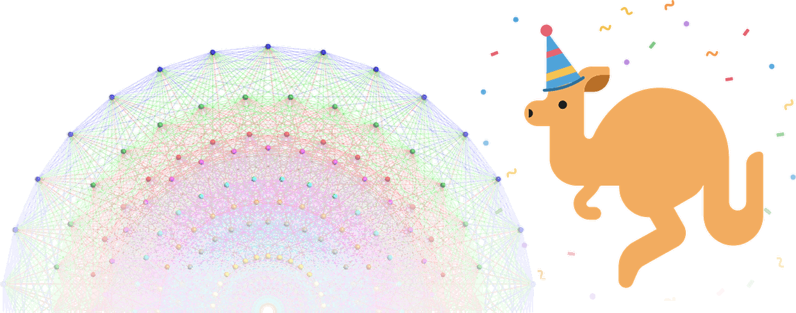

My extended abstract, <a href="https://openreview.net/forum?id=TRufFt1C7Z" target="_blank" rel="noopener"><em>Language Organizes Color Geometry in Multilingual Encoders</em></a>, was accepted to <a href="https://www.neurreps.org/" target="_blank" rel="noopener">NeurReps 2026</a>, the Symmetry and Geometry in Neural Representations workshop at <a href="https://neurips.cc/" target="_blank" rel="noopener">NeurIPS 2026</a> in Sydney, Australia.

